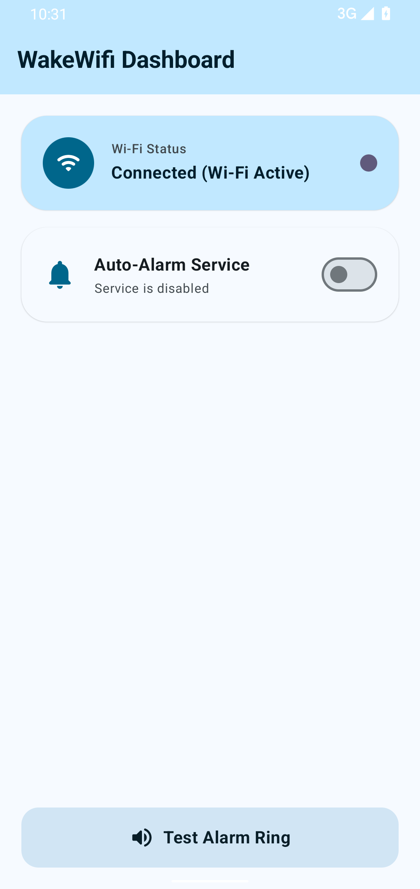

# WakeWifi

An Android app that rings an alarm **the moment your phone connects to Wi-Fi** —
and only Wi-Fi. Mobile data is deliberately ignored.

<p align="center">
  
</p>

[](https://github.com/gorzkie-graffiti/wakewifi/releases/latest)

Built with Kotlin, Jetpack Compose, and Material 3.

## Features

- **Wi-Fi-only monitoring** using `ConnectivityManager` and
  `NetworkCapabilities` (`TRANSPORT_WIFI`).
- **Alarm on transition**: the alarm fires when the phone moves from
  disconnected/other transport to a Wi-Fi network with internet access. It does
  not re-fire every time the network capabilities update.
- **Foreground service** so monitoring survives the app being backgrounded.
- **Persistent notification** with a stop-alarm action.
- **30-second auto-stop** so a forgotten alarm doesn't ring forever.
- **Manual test alarm** and a stop button in the UI.
- Simple dashboard: monitoring on/off, live Wi-Fi status, alarm status.

## Requirements

- Android Studio (or the Android SDK + JDK 17+)
- Android SDK 37
- Android 9.0 (API 28) or newer

## Build

```bash
git clone https://github.com/gorzkie-graffiti/wakewifi.git
cd wakewifi

./gradlew assembleDebug
```

The APK is written to:

```
app/build/outputs/apk/debug/app-debug.apk
```

Install it on a connected device:

```bash
adb install -r app/build/outputs/apk/debug/app-debug.apk
```

## Signing

Release builds are signed automatically when `keystore.properties` exists in the
repository root:

```bash
cp keystore.properties.example keystore.properties
# then fill in storeFile, storePassword, keyAlias, and keyPassword
```

`keystore.properties` and the keystore itself are gitignored. **Back up both** —
if you lose the key, you cannot publish updates that install over existing
installs. Without `keystore.properties`, `assembleRelease` produces an unsigned
APK.

## Usage

1. Open the app.
2. Grant the notification permission (Android 13+).
3. Turn **Monitoring** on.
4. Leave the app or lock the screen.
5. Connect to a Wi-Fi network. The alarm rings and the notification changes to
   **Wi-Fi Connected! Alarm ringing!**
6. Press **Stop Alarm** in the app or in the notification.

The alarm uses the system alarm sound. If no alarm sound is configured, it falls
back to the notification sound and then the ringtone.

## Permissions

| Permission | Why |
| --- | --- |
| `ACCESS_NETWORK_STATE` | Read the active network and its capabilities. |
| `FOREGROUND_SERVICE` | Keep monitoring alive in the background. |
| `FOREGROUND_SERVICE_CONNECTED_DEVICE` | Required for the `connectedDevice` foreground service type. |
| `POST_NOTIFICATIONS` | Show the persistent monitoring notification (Android 13+). |
| `WAKE_LOCK` | Let the alarm keep playing while the device is dozing. |

No internet permission is requested. The app never phones home.

## How it works

```
MainActivity (Compose UI)
        │
        ├── MainViewModel ── live Wi-Fi status (Wi-Fi transport only)
        │
        └── WakeWifiForegroundService
                ├── WifiMonitorManager
                │       └── ConnectivityManager.NetworkCallback
                │               └── fires only on disconnected -> Wi-Fi transition
                └── AlarmEngine
                        └── MediaPlayer / RingtoneManager, 30s timeout
```

`WifiMonitorManager` keeps an internal `isConnectedToWifi` flag. The callback is
registered with a `NetworkRequest` that asks for `TRANSPORT_WIFI` and
`NET_CAPABILITY_INTERNET`, so a mobile-data handover never triggers the alarm.

## Project layout

```
app/src/main/java/dev/krystian/wakewifi/
├── MainActivity.kt
├── MainViewModel.kt
├── audio/
│   └── AlarmEngine.kt
├── network/
│   └── WifiMonitorManager.kt
├── service/
│   └── WakeWifiForegroundService.kt
└── ui/theme/
```

## Limitations

- The app reacts to the phone **joining** a Wi-Fi network, not to an already
  connected network when monitoring is switched on. If you enable monitoring
  while already on Wi-Fi, it waits for the next reconnect.
- The alarm is the system alarm sound; there is no custom sound picker yet.
- Monitoring state is not persisted across app/process restarts.
- This is an MVP, not a Play Store-ready release (no signed release build, no
  custom icon yet).

## License

MIT — see [LICENSE](LICENSE).
